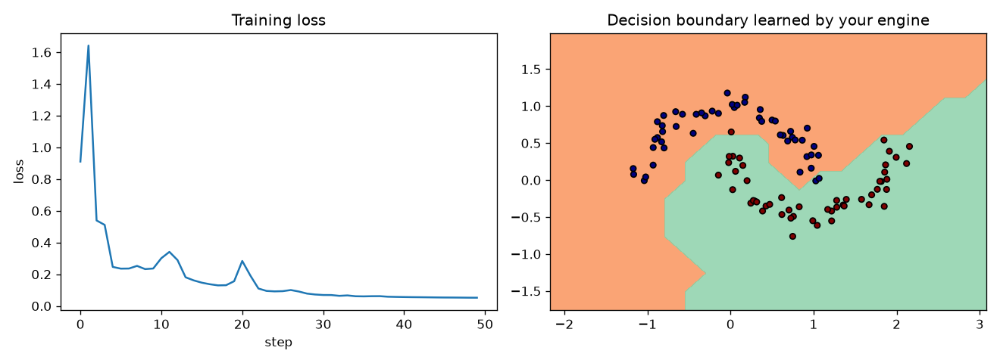

# scratch-ml

Building ML from scratch to understand how it really works: neural nets, loss functions, transformers and LLMs.
Each folder is one step, with code I wrote and notes in my own words.

## Progress

| Week | Topic | What's here |
|---|---|---|
| 1 | Backprop + autograd | micrograd from Karpathy's video, plus my exercises: rebuilt the `Value` engine, added `relu`, wrote a numerical gradient checker, trained an MLP on moons |

## Week 1: micrograd

**What I built**
- A tiny autograd engine (`Value`) that tracks operations and runs backprop through them
- `relu`, plus a gradient checker comparing my gradients to finite differences
- An MLP (2 → 16 → 16 → 1) trained with hinge loss + L2 regularization on `make_moons`: **~98% accuracy**

**What I learned**
- Each operation stores a small `_backward` function. `backward()` calls them in reverse topological order, so a node's gradient is complete before it's passed on.
- Gradients use `+=` because a value can feed into more than one place (`a + a` gives a gradient of 2, not 1).
- Forgetting to zero gradients between steps makes them accumulate, and training breaks.
- Hinge loss only penalizes points that are wrong or inside the margin. L2 keeps weights small, so the boundary stays smooth.

## Stack
Python, NumPy, PyTorch (to check gradients), matplotlib, Colab
